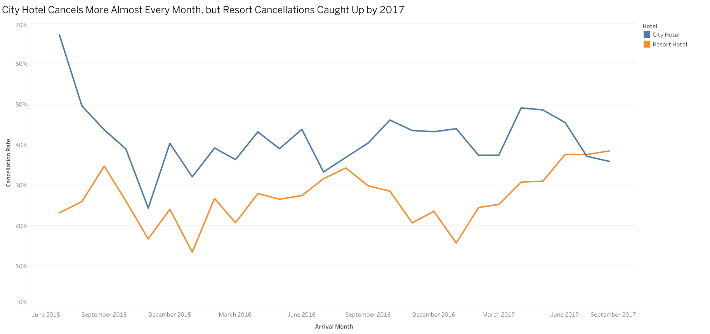

# Hotel Booking Dashboard

Interactive Dash app analyzing hotel booking cancellations for hotel revenue managers.
Dataset: [Hotel Booking Demand](https://www.kaggle.com/datasets/jessemostipak/hotel-booking-demand) (Antonio et al., 2019).

## Tableau Draft (Milestone 1)

### Chart 3: Cancellation Trend
City Hotel cancels more almost every month, but Resort cancellations caught up by 2017.

[View interactive version on Tableau Public](https://public.tableau.com/app/profile/avanish.rawat/viz/HotelBookingCancellationsChart3CancellationTrend_/Chart3)

### Chart 2: Lead Time vs. Average Daily Rate
Bookings made further ahead cancel more.

