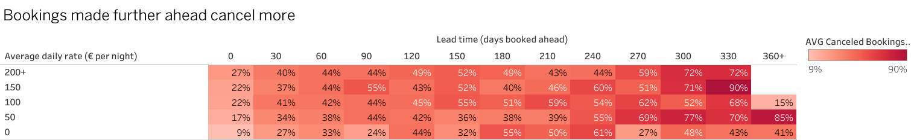

# Hotel Booking Dashboard

Interactive Dash app analyzing hotel booking cancellations for hotel revenue managers.
Dataset: [Hotel Booking Demand](https://www.kaggle.com/datasets/jessemostipak/hotel-booking-demand) (Antonio et al., 2019).

**Live app:** https://hotel-booking-dashboard-4b15.onrender.com/
(hosted on Render's free plan, so the first load after a quiet period can take about a minute)

## Dataset

| | |
|---|---|
| **Name** | [Hotel Booking Demand](https://www.kaggle.com/datasets/jessemostipak/hotel-booking-demand) (Kaggle) |
| **Original source** | N. Antonio, A. de Almeida and L. Nunes, "Hotel booking demand datasets," *Data in Brief*, vol. 22, pp. 41–49, 2019 |
| **License** | [CC BY 4.0](https://creativecommons.org/licenses/by/4.0/) |
| **File** | [`data/hotel_bookings.csv`](data/hotel_bookings.csv) |
| **Size** | 119,390 rows (bookings) × 32 columns |
| **After cleaning** | 119,208 rows |

### Attribute types

| Type | Count | Columns |
|---|---|---|
| Categorical | 11 | `hotel`, `arrival_date_month`, `meal`, `country`, `market_segment`, `distribution_channel`, `reserved_room_type`, `assigned_room_type`, `deposit_type`, `customer_type`, `reservation_status` |
| Numerical | 20 | `is_canceled` (0/1), `lead_time`, `arrival_date_year`, `arrival_date_week_number`, `arrival_date_day_of_month`, `stays_in_weekend_nights`, `stays_in_week_nights`, `adults`, `children`, `babies`, `is_repeated_guest`, `previous_cancellations`, `previous_bookings_not_canceled`, `booking_changes`, `agent`, `company`, `days_in_waiting_list`, `adr` (average daily rate, €), `required_car_parking_spaces`, `total_of_special_requests` |
| Date | 1 | `reservation_status_date` |

## Cleaning

Done in [`data/clean.py`](data/clean.py).

| Step | Column(s) | What we did | Rows affected |
|---|---|---|---|
| Missing values | `children` | 4 missing values set to 0 | 0 removed |
| Missing values | `country` | 488 missing values set to "Unknown" | 0 removed |
| Missing values | `agent`, `company` | Columns dropped: mostly-empty ID numbers (16,340 and 112,593 missing) | 0 removed |
| Removed rows | `adr` | Average daily rate below €0 or €1,000 and above (data-entry errors) | 182 removed in total |
| Removed rows | `adults`, `children`, `babies` | Bookings with zero guests | (included above) |
| Type fix | `arrival_date` (new) | One real date built from year, month *name* (text) and day | — |
| Type fix | `arrival_month_num` (new) | Month as a number 1–12, so months sort in calendar order | — |
| Derived column | `total_nights` (new) | `stays_in_weekend_nights` + `stays_in_week_nights` | — |
| Derived in charts | cancellation rate | Share of bookings with `is_canceled` = 1 | — |
| Derived in charts | lead-time and ADR ranges | 30-day and €50 bins used by Chart 2 | — |

## Tableau Draft (Milestone 1)

### Chart 2: Lead Time vs. Average Daily Rate
Bookings made further ahead cancel more.

[View interactive version on Tableau Public](https://public.tableau.com/app/profile/dhyani.soni/viz/Project-DS450/Chart2)

### Chart 3: Cancellation Trend
City Hotel cancels more almost every month, but Resort cancellations caught up by 2017.

[View interactive version on Tableau Public](https://public.tableau.com/app/profile/avanish.rawat/viz/HotelBookingCancellationsChart3CancellationTrend_/Chart3)